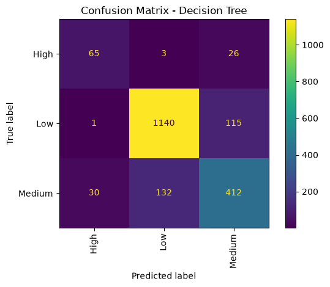

# SME Financial Health Prediction

This project uses machine learning to predict the financial health of small and medium-sized enterprises (SMEs). The model classifies each business into one of three categories: **Low, Medium, or High**.

I worked on this project to practice data analysis, data preprocessing, and classification using Python and scikit-learn.

## Dataset

The dataset comes from the **data.org Financial Health Prediction Challenge on Zindi**.

The data contains survey responses from small and medium-sized business owners in Southern Africa. It includes information about their businesses, financial activities, access to financial services, and ability to manage financial challenges.

The goal is to predict the Financial Health Index category for each business.

- Training data: `Train.csv`
- Test data: `Test (1).csv`
- Submission format: `SampleSubmission.csv`

**Dataset source:** [data.org Financial Health Prediction Challenge – Zindi](https://zindi.africa/competitions/dataorg-financial-health-prediction-challenge/data)

The dataset files are not included in this repository. Download them from the competition page if you want to run the notebook.

## What I Did

The project follows the usual steps of a machine learning workflow:

- Loaded the training and test datasets.
- Checked the columns, data types, missing values, and duplicate records.
- Explored the distribution of the three financial health categories.
- Prepared numerical and categorical features for training.
- Compared different classification algorithms.
- Evaluated the models using validation data.
- Generated predictions for the test dataset.

## Models

The notebook explores these classification algorithms:

- Logistic Regression
- Decision Tree
- Random Forest
- Extra Trees Classifier

The models are compared using validation results rather than assuming that one algorithm will always perform best.

## Tools Used

- Python
- Pandas
- NumPy
- Matplotlib
- Scikit-learn
- Jupyter Notebook
- Joblib

